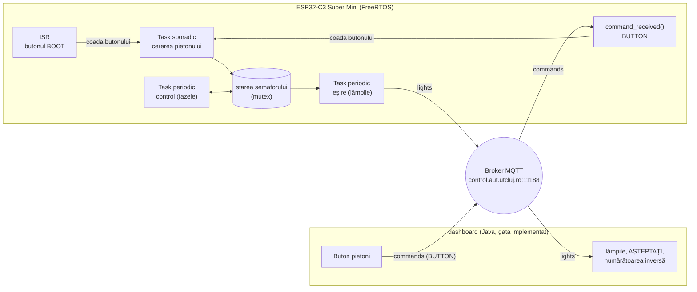
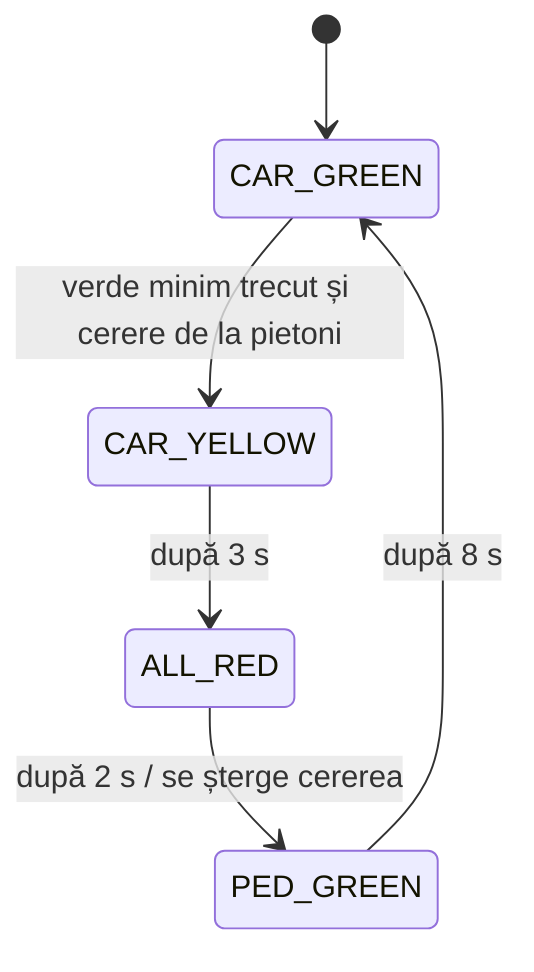

# Tema 03 – Semafor pentru pietoni pe ESP32-C3

**Tehnologii:** ESP32-C3 Super Mini, Arduino IDE, FreeRTOS, MQTT, Java 17+ (dashboard)
**Termen de predare:** _de stabilit_

## Obiective

După rezolvarea temei, veți putea să:

- implementați un automat cu stări (fazele unui semafor) într-un **task periodic**;
- rulați **două taskuri periodice** cu perioade diferite pe același procesor și să le alegeți prioritățile;
- tratați un eveniment extern printr-o **rutină de întrerupere** (ISR) și un **task sporadic**;
- protejați o stare partajată de mai multe taskuri cu un **mutex**.

## Problema

Placa ESP32-C3 controlează o **trecere de pietoni cu buton**, ca acelea de pe străzile cu trafic mare, unde pietonii primesc verde doar la cerere.

Ce vede un pieton:

1. Mașinile au verde, pietonii au roșu. Semaforul rămâne așa oricât de mult, cât timp nu apasă nimeni butonul.
2. Pietonul apasă butonul. Se aprinde lampa **AȘTEPTAȚI**: cererea lui a fost înregistrată.
3. Dacă mașinile au avut verde cel puțin 10 s, semaforul pentru mașini trece imediat pe galben. Dacă nu, verdele pentru mașini continuă până la 10 s, apoi urmează galbenul.
4. După galben, toată lumea are roșu 2 s, ca mașinile care au trecut pe galben să iasă din intersecție.
5. Pietonii primesc verde 8 s, iar lampa AȘTEPTAȚI se stinge. O **numărătoare inversă** arată câte secunde mai au.
6. Pietonii primesc roșu, iar mașinile primesc din nou verde.

Placa nu are lămpi. Lămpile sunt desenate de un **dashboard** (aplicație Java, gata implementată), care le aprinde și le stinge exact după mesajele publicate de placă. Pentru placă, dashboard-ul este „hardware-ul” semaforului: el nu ia nicio decizie, toată logica este pe placă. Dacă placa greșește (de exemplu, dă verde pietonilor cu mașinile pe verde), dashboard-ul desenează exact greșeala și o semnalează.



Butonul pentru pietoni există de două ori: butonul **BOOT** de pe placă și butonul **Buton pietoni** din dashboard. Amândouă ajung în aceeași coadă și sunt tratate de același task sporadic. Butonul din dashboard vă permite să lucrați și fără să atingeți placa; dashboard-ul afișează și cât a durat până s-a aprins lampa AȘTEPTAȚI.

## Fazele semaforului

Semaforul este un **automat cu stări**: în fiecare moment se află într-o singură fază, iar faza determină complet ce lămpi sunt aprinse. Numele fazelor încep cu `CAR_` (faze în care contează semaforul pentru mașini) sau `PED_` (pedestrians, faza pentru pietoni).

| Faza | Mașini | Pietoni | Durata | Se termină când | Urmează |
|------|--------|---------|--------|-----------------|---------|
| `CAR_GREEN` | verde | roșu | cel puțin `CAR_GREEN_MIN_MS` (10 s) | a trecut verdele minim **și** există o cerere de la pietoni | `CAR_YELLOW` |
| `CAR_YELLOW` | galben | roșu | `CAR_YELLOW_MS` (3 s) | trece timpul | `ALL_RED` |
| `ALL_RED` | roșu | roșu | `ALL_RED_MS` (2 s) | trece timpul | `PED_GREEN` |
| `PED_GREEN` | roșu | verde | `PED_GREEN_MS` (8 s) | trece timpul | `CAR_GREEN` |



Câteva observații despre faze:

- Durata unei faze se măsoară **de la intrarea în ea**. Verdele minim pentru mașini se numără de la intrarea în `CAR_GREEN`, nu de la apăsarea butonului.
- `CAR_GREEN` nu are o durată fixă: se termină doar dacă există o cerere. Celelalte trei faze se termină doar prin trecerea timpului.
- Toate duratele sunt constante, în `config.h`.

### Un ciclu complet, pas cu pas

Mașinile au verde de mult (peste 10 s), iar un pieton apasă butonul la $t = 0$:

| $t$ | Faza | Mașini | Pietoni | AȘTEPTAȚI | Numărătoarea |
|-----|------|--------|---------|-----------|--------------|
| 0 s | `CAR_GREEN` | verde | roșu | **aprinsă** | – |
| ≈ 0 s | `CAR_YELLOW` | galben | roșu | aprinsă | – |
| 3 s | `ALL_RED` | roșu | roșu | aprinsă | – |
| 5 s | `PED_GREEN` | roșu | verde | stinsă (cererea s-a șters) | 8, 7, …, 1 |
| 13 s | `CAR_GREEN` | verde | roșu | stinsă | – |

Dacă apăsarea vine după numai 3 s de verde pentru mașini, lampa AȘTEPTAȚI se aprinde imediat, dar galbenul începe abia la 10 s de la intrarea în `CAR_GREEN`. Restul ciclului este același.

### Reguli

- **Cererea pietonului** (lampa AȘTEPTAȚI) se înregistrează la apăsarea butonului și se șterge la intrarea în `PED_GREEN`, când pietonul primește ce a cerut. Mai multe apăsări înainte de `PED_GREEN` înseamnă tot o singură cerere.
- O apăsare în timpul fazei `PED_GREEN` rămâne înregistrată: după ce mașinile își primesc verdele minim, urmează un nou ciclu pentru pietoni.
- **Numărătoarea inversă** arată secundele rămase din `PED_GREEN`, rotunjite în sus: la intrarea în fază arată 8, cu 7,2 s rămase arată tot 8, cu 0,3 s rămase arată 1. În celelalte faze este 0, iar dashboard-ul nu o afișează.

Dashboard-ul verifică două **reguli de siguranță** și semnalează în roșu orice încălcare:

- pietonii au verde doar când mașinile au roșu;
- verdele pentru mașini trece în roșu doar prin galben.

Dacă fazele și lămpile respectă tabelul de mai sus, regulile sunt respectate automat.

## Taskurile de pe placă

| Activitate | Tip | Eliberare | Ce face |
|------------|-----|-----------|---------|
| control | periodic | `CONTROL_PERIOD_MS` = 100 ms | decide faza curentă (automatul de mai sus); nu publică nimic |
| ieșire | periodic | `OUTPUT_PERIOD_MS` = 500 ms | stabilește lămpile din faza curentă, le publică pe `lights`, aprinde LED-ul plăcii cât timp lampa AȘTEPTAȚI e aprinsă |
| ISR buton | întrerupere | apăsarea butonului BOOT | pune apăsarea în coada butonului și atât |
| buton | sporadic | apăsare; intervalul minim între sosiri `MIN_INTERARRIVAL_MS` = 1000 ms | respinge apăsările prea dese, înregistrează cererea pietonului |

### Cele două taskuri periodice

Cele două taskuri periodice lucrează în paralel, cu perioade diferite, și își împart munca: **controlul** decide *ce* fază este, **ieșirea** decide *ce se vede*. Nu se apelează unul pe altul și nu își trimit mesaje: comunică doar prin starea semaforului.

Un job al **taskului de control** (la fiecare 100 ms):

1. ia mutexul stării;
2. calculează de cât timp durează faza curentă (momentul de acum minus momentul intrării în fază);
3. verifică condiția de ieșire din faza curentă (coloana „Se termină când”);
4. dacă e îndeplinită, trece în faza următoare și notează momentul intrării; la intrarea în `PED_GREEN` șterge cererea pietonului;
5. eliberează mutexul și, dacă faza s-a schimbat, afișează pe Serial faza nouă.

Un job al **taskului de ieșire** (la fiecare 500 ms):

1. copiază starea într-o variabilă locală, cu mutexul luat, și eliberează mutexul;
2. din faza copiată, stabilește culoarea celor două lămpi;
3. calculează secundele rămase pentru pietoni;
4. publică mesajul `lights` și aprinde sau stinge LED-ul plăcii după lampa AȘTEPTAȚI.

Taskul de control observă că o fază s-a terminat abia la primul job de după expirarea duratei, deci o fază poate dura cu până la o perioadă (100 ms) mai mult decât în `config.h`. Perioada de 500 ms a ieșirii limitează traficul MQTT la două mesaje pe secundă.

### Taskul sporadic

Taskul sporadic este eliberat de evenimente, nu de ceas: stă blocat în `xQueueReceive` până sosește o apăsare în coada butonului. Spre deosebire de un task aperiodic, are un **interval minim între sosiri** garantat: apăsările care sosesc la mai puțin de `MIN_INTERARRIVAL_MS` de ultima apăsare acceptată sunt respinse. Așa, oricât de repede ar apăsa cineva, taskul nu face mai mult de o înregistrare pe secundă.

### Starea partajată și mutexul

În tema 02, taskurile comunicau doar prin cozi. Aici, trei taskuri lucrează cu **aceeași stare**:

| Câmpul stării | Scris de | Citit de |
|---------------|----------|----------|
| faza curentă și momentul intrării în ea | control | control, ieșire |
| cererea pietonului | sporadic (o setează), control (o șterge) | control, ieșire |

Fără protecție, un task poate citi starea în mijlocul unei modificări făcute de altul. De exemplu, taskul de ieșire poate vedea faza nouă cu momentul de intrare al fazei vechi și calculează o numărătoare greșită. Exemplul [`02_mutex_stare_partajata`](exemple/02_mutex_stare_partajata/02_mutex_stare_partajata.ino) arată cât de des se întâmplă asta. De aceea accesul la stare se face cu un **mutex** (`xSemaphoreCreateMutex`, `xSemaphoreTake`, `xSemaphoreGive`):

- mutexul se ține **cât mai puțin**: doar citirea sau scrierea câmpurilor. Taskul de ieșire, de exemplu, copiază starea într-o variabilă locală și eliberează mutexul înainte să construiască și să publice mesajul;
- cât timp țineți mutexul: fără `mqtt_publish()`, fără `Serial`, fără așteptări;
- ISR-ul **nu** folosește mutexul: el doar pune apăsarea în coadă. Starea o modifică taskul sporadic.

### Butonul BOOT și întreruperea

Butonul BOOT este legat la `GPIO9` (`BUTTON_PIN`) și dă `LOW` cât timp este apăsat. Scheletul îl configurează cu `INPUT_PULLUP`. Întreruperea se înregistrează în `setup()`, pe frontul descrescător (momentul apăsării):

```cpp
attachInterrupt(digitalPinToInterrupt(BUTTON_PIN), button_isr, FALLING);
```

Rutina de întrerupere se declară cu `IRAM_ATTR`, este scurtă și folosește doar funcțiile FreeRTOS cu sufixul `FromISR`:

```cpp
void IRAM_ATTR button_isr(void) {
    // ... elementul cozii, cu momentul apăsării (xTaskGetTickCountFromISR())
    BaseType_t woken = pdFALSE;
    xQueueSendFromISR(button_queue, &press, &woken);
    portYIELD_FROM_ISR(woken);  // dacă a fost trezit un task mai prioritar, rulează imediat
}
```

Contactele unui buton nu se închid curat (**bounce**): o singură apăsare produce adesea mai multe întreruperi, la câteva zeci de microsecunde sau câteva milisecunde distanță. Exemplul [`03_isr_coada`](exemple/03_isr_coada/03_isr_coada.ino) le arată. Nu le filtrați în ISR: le respinge taskul sporadic, prin intervalul minim între sosiri. Pentru asta, momentul fiecărei apăsări este pus în elementul cozii de cel care o trimite (ISR-ul sau `command_received()`), nu citit de task când o preia.

Nu țineți BOOT apăsat când apăsați RST sau conectați cablul: așa porniți bootloaderul, nu schița.

## Resurse puse la dispoziție

### `exemple/`

Șase schițe Arduino mici, fiecare cu un singur concept: așteptarea absolută, mutexul, ISR-ul cu coadă, taskul sporadic, taskul aperiodic, automatul cu două taskuri periodice. Exemplul cu taskul aperiodic nu este necesar pentru temă: recapitulează tema 02. Rulează doar cu placa la USB și Serial Monitor, fără Wi-Fi și MQTT. Rulați-le înainte să scrieți taskurile; ce urmăriți în fiecare este descris în [`exemple/README.md`](exemple/README.md).

### `start/dashboard/` (gata implementat)

Aplicația Java care desenează trecerea de pietoni. Nu aveți nimic de implementat în ea. Singura modificare: setați `STUDENT` în `Config.java`, identic cu `config.h`.

```bash
cd start/dashboard
mvn -q compile exec:java
```

Dashboard-ul:

- descoperă singur plăcile care publică pe `lights` și le pune în lista **Device**;
- desenează lămpile, lampa AȘTEPTAȚI și numărătoarea inversă, exact după ultimul mesaj; dacă placa nu mai trimite mesaje 2 s, stinge lămpile;
- verifică regulile de siguranță și afișează erorile;
- la **Buton pietoni**, trimite plăcii selectate comanda `BUTTON` și măsoară cât durează până se aprinde lampa AȘTEPTAȚI;
- afișează mesajele invalide.

### `start/esp32_semafor/`

Scheletul schiței Arduino. Ca în tema 02, comunicația este gata: Wi-Fi, ora (SNTP), clientul MQTT. Așa cum este, schița se conectează la broker și afișează pe Serial comenzile primite, dar nu publică nimic, deci dashboard-ul încă nu vede placa.

| Fișier | Ce conține |
|--------|------------|
| `config.h` | rețeaua Wi-Fi, brokerul, `STUDENT`, pinii, perioadele celor două taskuri periodice, duratele fazelor, `MIN_INTERARRIVAL_MS` |
| `connection.h`, `connection.cpp` | aceleași ca în tema 02, nu trebuie modificate: `wifi_connect()`, `time_sync()`, `epoch_ms()`, `mqtt_start()`, `mqtt_publish(kind, text)`, `command_received(text)` |
| `esp32_semafor.ino` | aici lucrați: fazele (`enum Phase`) și culorile (`enum Light`) cu numele lor din mesaje, apoi `TODO 0` … `TODO 3` |

Pentru Arduino IDE, plăci și probleme frecvente, vedeți [`exemple/README.md` din tema 02](../tema-02-esp32-mqtt/exemple/README.md). Pentru mutex, exemplul `two_tasks` din laboratorul 0 al [rt-labs-esp32c3](https://github.com/automatica-cluj/rt-labs-esp32c3) folosește unul pentru portul serial.

## Brokerul MQTT, topic-urile și mesajele

Brokerul este cel din temele 01 și 02: `control.aut.utcluj.ro`, portul `11188`, topic-urile sub `ssatr/<student>/devices/<deviceId>/`.

| Topic | Direcție | Publicat de | Conținut |
|-------|----------|-------------|----------|
| `.../esp32-a1b2c3/lights` | placă → dashboard | taskul de ieșire, la fiecare job | `esp32-a1b2c3;timestamp;faza;masini;pietoni;asteptati;secunde` |
| `.../esp32-a1b2c3/commands` | dashboard → placă | dashboard | `BUTTON` |

`timestamp` este ora exactă în milisecunde, dată de `epoch_ms()`. Câmpurile mesajului `lights`:

| Câmp | Valori |
|------|--------|
| `faza` | `CAR_GREEN`, `CAR_YELLOW`, `ALL_RED`, `PED_GREEN` |
| `masini` | `RED`, `YELLOW`, `GREEN` |
| `pietoni` | `RED`, `GREEN` |
| `asteptati` | `1` dacă lampa AȘTEPTAȚI este aprinsă (există o cerere), altfel `0` |
| `secunde` | numărătoarea inversă pentru pietoni; `0` = nu se afișează |

Numele fazelor și ale culorilor sunt deja în schelet, în `PHASE_NAMES` și `LIGHT_NAMES`. Exemple:

```
esp32-a1b2c3;1727600000000;CAR_GREEN;GREEN;RED;0;0     verde pentru mașini, nimeni nu așteaptă
esp32-a1b2c3;1727600004000;CAR_GREEN;GREEN;RED;1;0     verde pentru mașini, un pieton așteaptă
esp32-a1b2c3;1727600006000;ALL_RED;RED;RED;1;0         roșu pentru toți
esp32-a1b2c3;1727600009500;PED_GREEN;RED;GREEN;0;6     verde pentru pietoni, încă 6 s
```

Placa primește o singură comandă, `BUTTON`: o apăsare a butonului pentru pietoni, la fel ca butonul BOOT. Nu are confirmare: efectul ei se vede pe lampa AȘTEPTAȚI. Orice altă comandă se ignoră.

Detaliile din tema 02 rămân valabile:

- `command_received()` doar pune apăsarea în coadă, fără să se blocheze (timeout 0);
- elementele cozii conțin datele însele, nu pointeri;
- mutexul și coada se creează înainte de `mqtt_start()`, taskurile după;
- stiva fiecărui task are cel puțin 4096 de octeți;
- `Serial.setTxTimeoutMs(0)` rămâne în `setup()`.

## Cerințe

### 1. Placa ESP32 (`start/esp32_semafor/`)

Completați `TODO`-urile din `esp32_semafor.ino`. Comentariile din schelet detaliază fiecare `TODO`.

- **TODO 0 – structura aplicației**: starea semaforului și mutexul ei, coada butonului, pornirea celor trei taskuri și înregistrarea întreruperii. Prioritățile le alegeți voi, între 2 și 19; pentru cele două taskuri periodice, aplicați regula Rate Monotonic (perioada mai mică, prioritatea mai mare).
- **TODO 1 – taskul periodic de control**: automatul cu fazele din tabel, cu **așteptare absolută** (`xTaskDelayUntil`), fără derivă. Duratele se măsoară cu un timp monoton (`millis()`), nu cu `epoch_ms()`, care poate sări la o resincronizare a orei.
- **TODO 2 – taskul periodic de ieșire**: lămpile, numărătoarea inversă, mesajul `lights` la fiecare job și LED-ul plăcii pentru lampa AȘTEPTAȚI. Tot cu așteptare absolută.
- **TODO 3 – butonul**: ISR-ul pentru BOOT și taskul sporadic, cu intervalul minim între sosiri. Comanda `BUTTON` intră în aceeași coadă, din `command_received()`.

### 2. Funcționarea completă

Cu dashboard-ul pornit:

- fără apăsări, semaforul stă pe `CAR_GREEN`;
- o apăsare (BOOT sau **Buton pietoni**) aprinde lampa AȘTEPTAȚI și LED-ul plăcii și pornește ciclul complet, cu numărătoarea inversă;
- o apăsare venită devreme în `CAR_GREEN` aprinde lampa imediat, dar ciclul pornește abia după verdele minim;
- apăsările repetate rapid sunt respinse (mesaj pe Serial);
- dashboard-ul nu semnalează **nicio eroare de siguranță**.

### Ordinea de lucru recomandată

Nu scrieți tot codul deodată. Fiecare pas de mai jos se poate verifica separat:

1. **Conexiunea.** Setați `STUDENT` în `config.h` și în `Config.java`, încărcați scheletul neschimbat și porniți dashboard-ul. Placa nu apare încă în lista **Device**, pentru că nu publică nimic. Verificați totuși în Serial Monitor că placa s-a conectat la broker.
2. **Starea și ieșirea (TODO 0 parțial, TODO 2).** Definiți starea și mutexul, apoi scrieți doar taskul de ieșire. Placa apare în dashboard cu lămpile fazei inițiale. Schimbați temporar faza inițială (de exemplu `ALL_RED` sau `PED_GREEN`) și verificați că lămpile se văd corect.
3. **Controlul (TODO 1).** Adăugați taskul de control. Ca să-l încercați înainte de buton, porniți temporar cu cererea pietonului setată: după verdele minim de 10 s trebuie să vedeți un ciclu complet, cu duratele din tabel, apoi semaforul rămâne pe `CAR_GREEN`. Pe Serial apare fiecare schimbare de fază.
4. **Butonul (TODO 3).** ISR-ul, coada butonului și taskul sporadic. Încercați BOOT și **Buton pietoni**, rar și des.

## Predare

Soluția se află în fork-ul vostru, în folderul `tema-03-semafor-simplu/`:

```
tema-03-semafor-simplu/
└── start/
    ├── esp32_semafor/        # schița completată
    └── dashboard/            # doar STUDENT setat în Config.java
```

**Nu urcați în fork parola rețelei voastre Wi-Fi.** Înainte de commit, puneți înapoi în `config.h` valorile pentru `iot-demo`.

După push, adăugați commit ID-ul soluției (`git rev-parse HEAD`) ca **comentariu** la assignment-ul temei din **Microsoft Teams** și apăsați **Turn in**. Detalii în [README-ul principal](../README.md#predare).

## Bibliografie

- Cursul: [2.3 Eliberare periodică](https://control.aut.utcluj.ro:8030/part-02-time/03-periodic-release/), [3.2 Modelul de task](https://control.aut.utcluj.ro:8030/part-03-scheduling/02-task-model/)
- [rt-labs-esp32c3](https://github.com/automatica-cluj/rt-labs-esp32c3): laboratorul 0 (`two_tasks`), `docs/freertos_concepts.md`
- [FreeRTOS: mutex](https://www.freertos.org/Documentation/02-Kernel/02-Kernel-features/02-Queues-mutexes-and-semaphores/04-Mutexes), [`xQueueSendFromISR`](https://www.freertos.org/Documentation/02-Kernel/04-API-references/06-Queues/04-xQueueSendFromISR), [`xTaskDelayUntil`](https://www.freertos.org/Documentation/02-Kernel/04-API-references/02-Task-control/03-xTaskDelayUntil)
- [Arduino-ESP32: GPIO și întreruperi](https://docs.espressif.com/projects/arduino-esp32/en/latest/api/gpio.html)
